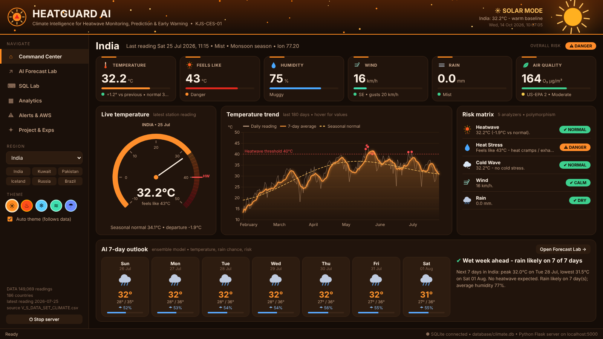

# HeatGuard AI: Heatwave Intelligence Dashboard (web version, runs on localhost)

**Python mini project** for use case **KJS-CES-01: Climate Intelligence for Heatwave Monitoring, Prediction, and Early Warning**
Sai Sanjay Zagade · Roll No. 16014225105 · SY B.Tech AI & DS (Batch B3) · K. J. Somaiya School of Engineering



---

## ▶ How to open it (no terminal needed)

1. **Install Python (one time only).** Download **Python 3.12** from https://www.python.org/downloads/. On the first installer screen, **tick ✅ "Add python.exe to PATH"** and click Install.
2. **Unzip** `HeatwaveDashboard.zip`: right-click it and choose **Extract All**.
3. Open the folder and **double-click `START_DASHBOARD.bat`**.
   * **First time only:** a setup window installs the libraries. This takes 1-3 minutes and needs internet. The window closes by itself.
   * Your browser then opens **http://localhost:5000**, and the dashboard loads in about 10 seconds. The first start also builds the database.
   * **From the second time on**, double-clicking opens the dashboard straight away. No terminal window appears, because the Python server runs hidden in the background.
4. **To close it**, click **⏻ Stop server** at the bottom of the sidebar, or double-click **`STOP_DASHBOARD.bat`**.

> 💡 You can bookmark **http://localhost:5000**. It works whenever the server is running.
> If Windows shows "Windows protected your PC", click **More info → Run anyway**. It is just a .bat file.

**Using VS Code instead?** Open the folder, press **F5**, and choose *"Run HeatGuard AI web dashboard"*. Or type `pip install -r requirements.txt` and then `python server.py`.

---

## What's inside

| Page | What it does |
|---|---|
| **Command Center** | Shows the latest reading for a country: a temperature dial, 6 KPI tiles, a 180-day trend you can hover over, a 5-analyzer risk matrix and an AI 7-day outlook. |
| **AI Forecast Lab** | Predicts **temperature (with an 80% band), rain chance and humidity** for 7 / 14 / 30 days. It writes a message for each day, shows an early-warning banner, measures model accuracy and gives advice for citizens, farmers, the health department and authorities. You can save the forecast to SQLite or export it as CSV. |
| **SQL Lab** (Exp 8) | Runs **any SQLite query**. You get a syntax-highlighted editor, 27 preset queries, a schema browser, history, a results table and an **automatic chart**, and **the whole theme changes based on your query**. |
| **Analytics** | Heat calendar, IMD season distribution, wind rose and correlation matrix; plus global hotspots, a world heat band, the coldest regions and the global temperature pulse. |
| **Alerts & AWS** | 3 **sensor threads** simulate IoT weather stations. Faulty values are caught as exceptions, and alerts pop up and are saved to SQLite. Demo buttons: heat spike, cold snap, wind gust. |
| **Project & Exps** | Shows where each of Experiments 1-8 is used, the use-case phases, a viva demo script and the data-cleaning report. |

### The theme follows the data
| Theme | When |
|---|---|
| ☀ **SOLAR** (orange, default) | Normal, warm conditions |
| ♨ **BLAZE** (fire, rising embers) | `MAX(temperature)`, readings ≥ 35 °C, heatwave forecasts and alerts, INSERTing a hot reading |
| ❄ **FROST** (ice, falling snow) | `MIN(temperature)`, readings ≤ 8 °C, freezing or snow queries |
| ≋ **GALE** (wind streaks) | Wind or gust queries, high-wind alerts |
| ☂ **MONSOON** (rain + lightning) | Rain, precipitation or humidity queries, rainy forecasts |

You can also click the coloured circles in the sidebar to pick a theme yourself. Tick **Auto theme** to switch back to automatic.

### Pop-up alerts
* Toast notifications slide in at the bottom-right: the startup heatwave scan, forecast early warnings, AWS sensor alerts and query results.
* Severe events (for example a 47 °C reading) open a **flashing SEVERE EARLY WARNING pop-up** with advice for each stakeholder.
* Every alert is stored in the SQLite table `alerts`.

---

## Viva demo (about 3 minutes)
1. **Command Center:** click **India → Kuwait → Iceland** in the sidebar. The theme turns warm, then fiery, then icy.
2. **AI Forecast Lab:** pick **14 days + AI Ensemble**. Hover over the chart and switch between the stakeholder tabs.
3. **SQL Lab:** run **"MAX temperature per country"** for 🔥 fire mode, then **"MIN temperature per country"** for ❄ ice mode.
4. **SQL Lab:** run **"INSERT a 47 C heatwave reading (demo)"**. The database changes and a **SEVERE pop-up** appears. The Command Center now shows 47 °C. Run **"DELETE the demo rows again"** to undo it.
5. **Alerts & AWS:** press **Start AWS monitor**, then **Heat spike**. You will see the threads, the caught faults and the live alerts.
6. **SQL Lab → "Alert log"** shows every alert that was saved to SQLite.

## Write your own SQL
Table **`weather_data`**: `id, country, longitude, timezone, recorded_at, date, month, year, season, temperature, condition, wind_kph, wind_degree, wind_direction, precip_mm, humidity, visibility_km, gust_mph, ozone, aqi_index, heat_index, is_rain`
Other tables: **`alerts`**, **`forecasts`**. View: **`country_summary`**.
```sql
SELECT country, MAX(temperature) AS max_temp FROM weather_data GROUP BY country ORDER BY max_temp DESC LIMIT 10;
SELECT season, ROUND(AVG(temperature),1) AS avg_temp FROM weather_data WHERE country='India' GROUP BY season;
SELECT country, COUNT(*) AS hot_days FROM weather_data WHERE temperature >= 40 GROUP BY country HAVING COUNT(*) > 5;
UPDATE weather_data SET temperature = temperature + 2 WHERE country = 'India' AND date >= '2026-07-01';
```
**Ctrl + Enter** runs the query. Double-click a result row that has a `country` column to open that country. If the data breaks, use **Reset database**.

---

## Project structure
```
HeatwaveDashboard/
├── START_DASHBOARD.bat        ← DOUBLE-CLICK THIS (Windows)
├── STOP_DASHBOARD.bat         ← stops the background server
├── START_DASHBOARD_mac_linux.command
├── server.py                  ← BACK END: Flask web server + REST API (/api/...)
├── web/                       ← FRONT END
│   ├── index.html             page layout (6 pages)
│   └── static/  style.css (5 themes) · app.js (logic, pop-ups, particles) · charts.js (D3 charts) · d3.min.js
├── heatguard/                 ← Python package used by the server
│   ├── config.py              thresholds, IMD seasons            (Exp 6 collections)
│   ├── exceptions.py          custom exceptions                  (Exp 5)
│   ├── text_tools.py          string cleaning & formatting       (Exp 3)
│   ├── models.py              WeatherRecord, Location→Station→AWS (Exp 1, 2, 3)
│   ├── analyzers.py           ABC + 5 polymorphic analyzers      (Exp 4)
│   ├── data_manager.py        CSV → clean → SQLite → pandas      (Exp 5, Phase I)
│   ├── database.py            SQLite tables, view, query runner  (Exp 8)
│   ├── analytics.py           lambda / map / filter / reduce     (Exp 6, Phase II)
│   ├── forecaster.py          AI models + backtest               (Exp 4, Phase II/IV)
│   ├── advisories.py          stakeholder advice                 (Phase V)
│   ├── monitor.py             IoT AWS sensor threads             (Exp 5, Phase III)
│   ├── theme_rules.py         query/reading → theme
│   └── ui/                    optional Tkinter desktop version   (Exp 7)
├── desktop_version.py         optional: same project as a Tkinter window
├── data/V_S_DATA_SET_CLIMATE.csv
├── database/climate.db        created automatically on first run
└── docs/VIVA_GUIDE.md         explanation + likely viva questions
```

## How it meets the rubric
| Criterion | Where to show it |
|---|---|
| **Problem analysis & design (3)** | The 5 use-case phases are mapped to modules (Project page). The design is layered: data → SQLite → OOP models/analyzers → AI → REST API → web UI. |
| **Implementation & demonstration (5)** | Everything works and is demonstrated with the 6-step demo. All 8 experiments are used inside one application. |
| **Documentation & viva (2)** | This README, `docs/VIVA_GUIDE.md`, a docstring in every file and the in-app Project page. |

## Troubleshooting
| Problem | Fix |
|---|---|
| "Python is not installed" | Install Python 3.12 from python.org and **tick Add python.exe to PATH**, then double-click again. |
| Setup failed | You need internet the first time. Delete the `.venv` folder and double-click `START_DASHBOARD.bat` again. |
| The browser didn't open | Open **http://localhost:5000** yourself. |
| The page keeps showing "Waiting for the Python server" | Look at `server.log` in the folder for the error message. |
| The data looks wrong after SQL experiments | **SQL Lab → Reset database**, or delete `database/climate.db` and start again. |
| Port 5000 is busy | Close the other program, or stop the old server with `STOP_DASHBOARD.bat`. |
